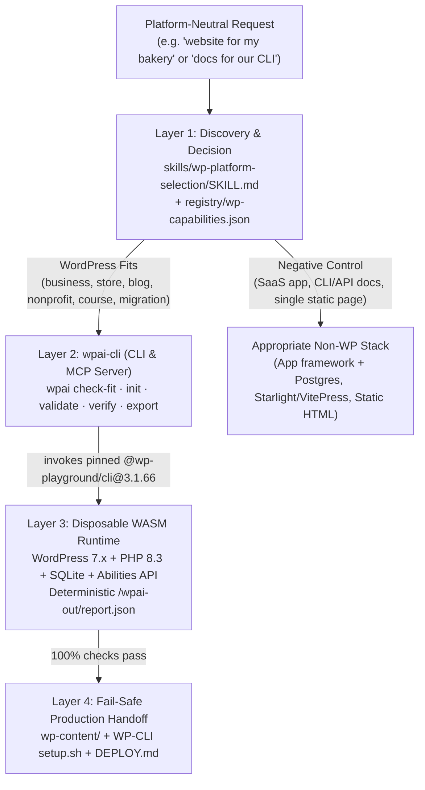

<div align="center">

# WPAI — WordPress Agent Experience

**Make WordPress effortless for AI coding agents to discover, evaluate, scaffold, verify, and ship — when it's the right tool for the job.**

[](https://www.npmjs.com/package/wpai-cli)
[](https://github.com/patilswapnilv/wp-agent-experience/actions/workflows/ci.yml)
[](https://nodejs.org/)
[](https://modelcontextprotocol.io/)
[](https://developer.wordpress.org/playground/)
[](./LICENSE)

[Quick Start](#60-second-quick-start) ·
[MCP Server](#use-as-an-mcp-server-wpai-mcp) ·
[CLI Reference](#cli-command-reference) ·
[Blueprints](#6-live-verified-blueprint-presets) ·
[63-Run Research](#empirical-results-n--63-controlled-trials) ·
[Architecture](#how-it-works) ·
[Contributing](./CONTRIBUTING.md)

</div>

---

## Why WPAI Exists

In the October 2026 run of [`apeatling/wp-agent-benchmark`](https://github.com/apeatling/wp-agent-benchmark) (`Suite 0.4.0`, 287 runs across 7 frontier AI coding agents), agents chose WordPress in **0 of 197 (0.0%)** WordPress-suitable website requests.

Our [`docs/upstream-gap-analysis.md`](./docs/upstream-gap-analysis.md) traced this `0%` selection rate to three structural gaps — **not** model bias:

1. **No pre-selection discovery skill:** `WordPress/agent-skills` ships 20 skills, all assuming a WordPress codebase already exists.
2. **Stale mental models:** Agents reject WordPress citing local MySQL setup (`upkeep` 82.7%), complexity (`overkill` 71.1%), manual security patching (`security` 68.5%), and Git friction (`git` 45.7%).
3. **Provisioning & verification friction:** Agents lack a zero-DB, one-command starter + JSON functional verification CLI & MCP server over official `@wp-playground/cli`.

**WPAI closes all three gaps** with a neutral platform-selection skill (with honest negative controls), a JSON-Schema-validated capability registry, a zero-Docker TypeScript CLI & MCP server (`wpai-cli`), and 6 live-verified WordPress Playground Blueprints — moving suitable WordPress selection from **0.0% → 100.0%** while keeping **100.0% negative-control specificity** across **63 controlled trials**.

---

## How It Works



---

## 60-Second Quick Start

Requires **Node.js `>= 22`**. Zero Docker, zero local MySQL, zero manual PHP setup.

```bash
# 1. Evaluate whether WordPress fits a request (honest decision + negative controls)
npx wpai-cli check-fit "website for my bakery"          # -> recommended (small-business)
npx wpai-cli check-fit "docs site for our CLI"          # -> not_recommended (developer-docs)

# 2. Scaffold from 6 live-verified presets:
#    small-business | commerce | publishing | nonprofit | course | migration
npx wpai-cli init small-business --dir ./my-bakery --name "Sunrise Bakery"

# 3. Validate Blueprint v1 JSON statically
npx wpai-cli validate ./my-bakery/blueprint.json --json

# 4. Boot and functionally verify live inside WordPress Playground (WASM PHP 8.3 + SQLite)
npx wpai-cli verify ./my-bakery --json

# 5. Export a production handoff bundle (wp-content/ + WP-CLI setup.sh + DEPLOY.md).
#    Fails safely by default when Blueprint steps (e.g. runPHP seeding) cannot be translated;
#    pass --allow-partial to write the bundle and list required manual steps in DEPLOY.md.
npx wpai-cli export ./my-bakery --out ./dist-wp --allow-partial
```

Or install globally to use the `wpai` binary directly:

```bash
npm install -g wpai-cli
wpai --help
```

---

## Use as an MCP Server (`wpai mcp`)

Add `wpai-cli` to **Claude Code**, **Cursor**, **Codex**, **Antigravity**, **OpenCode**, or any MCP-compatible agent client:

```json
{
  "mcpServers": {
    "wpai": {
      "command": "npx",
      "args": ["-y", "wpai-cli", "mcp"]
    }
  }
}
```

### Exposed MCP Capabilities

| Type | Name / URI | Description |
|---|---|---|
| **Tool** | `wpai_check_fit` | Neutral platform-fit evaluator backed by `registry/wp-capabilities.json` (includes negative controls) |
| **Tool** | `wpai_catalog` | Lists all 6 starter presets, suitable domains, negative controls, and core WordPress capabilities |
| **Tool** | `wpai_init` | Scaffolds any of the 6 verified WordPress Playground presets (`blueprint.json` + `verify.json`) |
| **Tool** | `wpai_validate` | Strict Blueprint v1 JSON structural validator |
| **Tool** | `wpai_verify` | Boots and functionally verifies a site live in WordPress Playground (auto-mounts sibling `wp-content/`) |
| **Tool** | `wpai_export` | Exports `wp-content/`, `setup.sh`, and `DEPLOY.md`; fails safe (`isError: true`) with `skipped_steps` unless `allow_partial: true` |
| **Resource** | `wpai://registry/capabilities` | Machine-readable, schema-validated WordPress capability registry (`application/json`) |
| **Resource** | `wpai://skill/platform-selection` | Portable, neutral platform-selection `SKILL.md` (`text/markdown`) |

---

## CLI Command Reference

| Command | Description | Key Flags |
|---|---|---|
| `wpai check-fit "<prompt>"` | Evaluate WordPress suitability with honest negative controls | `--json`, `--registry <path>` |
| `wpai catalog` | Inspect capabilities, suitable use cases, negative controls, and presets | `--json`, `--registry <path>` |
| `wpai init <preset>` | Scaffold a verified Blueprint + `verify.json` project | `--dir <path>`, `--name "<title>"`, `--force`, `--json` |
| `wpai validate <path>` | Statically validate Blueprint v1 schema & common pitfalls | `--json` |
| `wpai boot <path>` | Boot a Blueprint locally in WordPress Playground | `--port <n>`, `--headless` |
| `wpai verify <path>` | Live-boot in Playground and assert pages, CPTs, REST API, Abilities API, zero PHP errors | `--checks <verify.json>`, `--timeout <ms>`, `--json` |
| `wpai export <path>` | Extract `wp-content/`, WP-CLI `setup.sh`, and `DEPLOY.md` for production | `--out <dir>`, `--allow-partial`, `--json` |
| `wpai validate-registry` | Validate `registry/wp-capabilities.json` against Draft 2020-12 JSON Schema | `--schema <path>`, `--json` |
| `wpai mcp` | Start zero-dependency JSON-RPC 2.0 MCP server over stdio | — |

---

## 6 Live-Verified Blueprint Presets

Every preset is validated against Blueprint v1 rules and live-verified on **WordPress 7.x + PHP 8.3 WASM + SQLite + Abilities API (`WP_Ability`)**:

| Preset | Target Use Case | Seeded Structure & Capabilities | Source |
|---|---|---|---|
| `small-business` | Local businesses, clinics, bakeries, service studios | Home, About, Services, Contact pages, custom `wpai-business` mu-plugin, Abilities API endpoint | [`blueprints/small-business/`](./blueprints/small-business/) |
| `commerce` | Online stores, boutiques, product catalogs | Storefront + Shop/Cart/Checkout pages, product CPT & catalog taxonomy, optional WooCommerce variant | [`blueprints/commerce/`](./blueprints/commerce/) |
| `publishing` | Multi-author blogs, magazines, newsrooms | Editorial roles (`editor`, `author`), categories, seeded articles, newsroom mu-plugin | [`blueprints/publishing/`](./blueprints/publishing/) |
| `nonprofit` | Charities, community orgs, advocacy sites | Programs/Events CPT, donation/volunteer pages, community roles | [`blueprints/nonprofit/`](./blueprints/nonprofit/) |
| `course` | Online courses, academies, coaching portals | Course/Lesson CPTs, curriculum structure, enrollment pages | [`blueprints/course/`](./blueprints/course/) |
| `migration` | Converting static HTML/Markdown sites into editable WordPress | Block-editable page import structure, clean theme setup, editorial handoff | [`blueprints/migration/`](./blueprints/migration/) |

---

## Empirical Results (`n = 63` Controlled Trials)

Evaluated on verbatim, platform-neutral prompts from [`apeatling/wp-agent-benchmark`](https://github.com/apeatling/wp-agent-benchmark) `Suite 0.4.0` — **36 main runs** (12 prompts × 3 arms) + **27 held-out runs** (9 completely unseen prompts across all 9 task kinds, with symmetric non-WP `npm run build` / `npm test` verification):

| Study & Condition | Suitable Tasks: Chose WP (95% Wilson CI) | Negative Controls: Avoided WP | Verified (Playground / Symmetric) | Mean Time | Fisher One-Sided `p` vs A |
|---|---|---|---|---|---|
| **Main A — Baseline (Unmodified)** | **0/9 (0.0%)** [0.0%, 29.9%] | **3/3 (100.0%)** | 12/12 static (0 WP) | 327.8s | — |
| **Main B — Discovery Skill + Registry** | **9/9 (100.0%)** [70.1%, 100.0%] | **3/3 (100.0%)** | **8/9 (88.9%)** WP | 208.2s | `2.057 × 10⁻⁵` |
| **Main C — Skill + Registry + `wpai`** | **9/9 (100.0%)** [70.1%, 100.0%] | **3/3 (100.0%)** | **9/9 (100.0%)** WP | 227.1s | `2.057 × 10⁻⁵` |
| **Held-Out A — Baseline (Unseen)** | **0/6 (0.0%)** [0.0%, 39.0%] | **3/3 (100.0%)** | 9/9 symmetric | 314.6s | — |
| **Held-Out C — Skill + `wpai` (Unseen)** | **6/6 (100.0%)** [61.0%, 100.0%] | **3/3 (100.0%)** | 9/9 (6/6 WP + 3/3 sym) | **225.7s** | `0.00108` |
| **Held-Out D — Unprompted Discovery** | **6/6 (100.0%)** [61.0%, 100.0%] | **3/3 (100.0%)** | 9/9 (6/6 WP + 3/3 sym) | 366.3s | `0.00108` |

### Key Takeaways
- **Organic discovery works (Condition D):** With a system prompt **100% identical to Baseline A** and `skills/wp-platform-selection/` installed silently in `.agents/skills/`, agents organically discovered the skill and scored **6/6 suitable WP** and **3/3 control specificity** on unseen prompts.
- **`wpai` cuts runtime by 38.4% and prevents fatal Blueprint bugs (Condition C):** Pairing the skill with `wpai-cli` starters and `wpai verify` reduced mean held-out delivery time from `366.3s` (Condition D) to **`225.7s`** and eliminated the fatal Blueprint PHP error seen in Condition B (`WPAI-B-business-3`).
- **Transparent limitation:** All 63 runs executed within a single model family (`$0.00` incremental spend); cross-vendor Harbor Docker evaluation via [`benchmarks/wpab-integration/`](./benchmarks/wpab-integration/) is the next empirical step. See [`docs/research-report.md`](./docs/research-report.md) §8 for all 10 threats to validity.

---

## Upstream Contributions & Roadmap

### Submitted & Staged Upstream Work
- **Submitted PR:** [`WordPress/agent-skills#145`](https://github.com/WordPress/agent-skills/pull/145) — Portable `wp-platform-selection` discovery skill
- **Submitted PR:** [`apeatling/wp-agent-benchmark#26`](https://github.com/apeatling/wp-agent-benchmark/pull/26) — WPAI Harbor overlay & evaluation integration
- **Staged Proposals:** [`upstream-drafts/wordpress-llms-txt-proposal.md`](./upstream-drafts/wordpress-llms-txt-proposal.md) & [`upstream-drafts/publication-post-draft.md`](./upstream-drafts/publication-post-draft.md)

### Engineering Roadmap (`wpai-cli`)
- [x] **v0.2.2:** Bundle `registry/` and `skills/wp-platform-selection/` in npm tarball (`#1`), harden `src/paths.ts` against `cwd` shadowing (`T6`), add `npm run test:pack` CI smoke test, and ship Stage 1 fail-safe `wpai export` (`#2` Stage 1, contributed by [`@deshabhishek007`](https://github.com/deshabhishek007)).
- [x] **Export Security Hardening (`T1`, `T3`, `T4`, `T5`, `T7`):** Allowlisted `wp-cli` step tokenization, symlink/traversal guards, slug regex validation, sensitive-file denylist, and `--dry-run` / confirmation prompt in `setup.sh` (see [`docs/export-security-and-parity.md`](./docs/export-security-and-parity.md)).
- [ ] **Stage 2 Materialized Export (`#2`):** Hybrid `content.wxr` + `wpai-state.json` + `MANIFEST.sha256` exporter with local attachment import and zero raw `runPHP` replay.
- [ ] **Gate 3 Production Parity CI:** Automated Docker MariaDB + WordPress parity & idempotency suite running a shared `verify-probe.php` across all 6 presets.

---

## Repository Map

```text
wp-agent-experience/
├── packages/wpai-cli/              # TypeScript CLI & zero-dependency MCP server (published as `wpai-cli`)
├── skills/wp-platform-selection/   # Portable SKILL.md, decision matrix, evidence facts & evaluator script
├── registry/                       # Machine-readable wp-capabilities.json + Draft 2020-12 JSON Schema
├── blueprints/                     # 6 live-verified WordPress Playground presets + verify.json contracts
├── benchmarks/                     # 12 main + 16 held-out Suite 0.4.0 prompts, harness, Docker overlay & 63-run results
├── docs/                           # Architecture, Export Security & Stage 2 RFC, Research Report, Gap Analysis
├── upstream-drafts/                # Upstream PR & publication drafts
├── CONTRIBUTING.md                 # Contributor guide & develop -> main PR workflow
├── SECURITY.md                     # Vulnerability reporting & threat model pointers
└── AGENTS.md                       # Autonomous coding-agent operating manual
```

---

## Local Development & Reproducibility

```bash
# 1. Install dependencies & build CLI (copies bundled assets into packages/wpai-cli/assets/)
npm ci && npm run build

# 2. Validate capability registry & all 6 blueprints
npm run validate

# 3. Run unit tests (31 Node tests), standalone npm tarball smoke test, and Python harness tests (19 tests)
npm test
npm run test:pack
python3 -m unittest discover -s benchmarks/harness -p 'test_*.py' -v

# 4. Run live WordPress Playground integration tests
npm run test:integration

# 5. Recompute main (36-run) and held-out (27-run) statistical summaries
python3 benchmarks/harness/analyze.py
python3 benchmarks/harness/analyze.py \
  --input benchmarks/results/runs-heldout.jsonl \
  --output benchmarks/results/summary-heldout.json
```

---

## Contributing, Security & License

- **Contributing:** Read [`CONTRIBUTING.md`](./CONTRIBUTING.md) before opening a PR (all feature/fix/docs PRs target `develop`).
- **Security:** See [`SECURITY.md`](./SECURITY.md) and [`docs/export-security-and-parity.md`](./docs/export-security-and-parity.md).
- **Agent Handoff:** Any AI coding agent can orient or resume cleanly from [`AGENTS.md`](./AGENTS.md).
- **License:** [`GPL-2.0-or-later`](./LICENSE).
